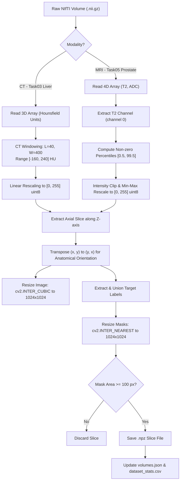

# Database and Preprocessing Architecture

This document provides a comprehensive technical reference for the data layer of the MedSAM evaluation repository. It details raw dataset ingestion, medical modality-specific intensity normalization, coordinate frame transformations, intermediate `.npz` database storage, metadata tracking, dataset splitting, embedding caching, and YOLO detector dataset generation.

---

## 1. Raw Datasets Overview

The project evaluates domain shift and generalizability using two benchmark datasets from the **Medical Segmentation Decathlon (MSD)**:

| Attribute | Task03_Liver | Task05_Prostate |
| :--- | :--- | :--- |
| **Imaging Modality** | Computed Tomography (CT) | Magnetic Resonance Imaging (T2-weighted MRI) |
| **Anatomical Target(s)** | Target 1: Liver parenchyma<br>Target 2: Liver lesions/tumors | Whole prostate gland (Union of PZ and TZ) |
| **MSD Label Map** | `0`: Background<br>`1`: Liver<br>`2`: Tumor | `0`: Background<br>`1`: Peripheral Zone (PZ)<br>`2`: Transition Zone (TZ) |
| **Evaluated Targets** | 2 binary targets: `liver`, `tumor` | 1 binary target: `prostate` (merged $1 \cup 2$) |
| **Raw Volume Dimension** | 3D volumes: $(X, Y, Z)$ | 4D volumes: $(X, Y, Z, C)$ where $C \in \{\text{T2}, \text{ADC}\}$ |
| **Total Available Volumes** | 131 clinical CT scans | 32 clinical MRI scans |
| **Cohort Subsampling** | Deterministic first 40 sorted volumes | All 32 volumes utilized |
| **Raw Archive Size** | ~27 GB (`Task03_Liver.tar`) | ~230 MB (`Task05_Prostate.tar`) |

### Acquisition & Storage Configuration
The raw data paths and preprocessing parameters are governed by YAML configuration files:
- [configs/msd_liver_ct.yaml](file:///c:/Users/Dhruv/VSCodeProjects/MedSAM/configs/msd_liver_ct.yaml)
- [configs/msd_prostate_mri.yaml](file:///c:/Users/Dhruv/VSCodeProjects/MedSAM/configs/msd_prostate_mri.yaml)

```yaml
# configs/msd_liver_ct.yaml
task: liver
raw_dir: datasets/raw/Task03_Liver
npz_dir: datasets/npz/liver
modality: CT
window_width: 400
window_level: 40
labels: {liver: 1, tumor: 2}      # each label evaluated as its own binary target
max_volumes: 40
split: {train: 0.8, val: 0.1, test: 0.1}
min_mask_pixels: 100              # in 1024x1024 space
image_size: 1024
```

```yaml
# configs/msd_prostate_mri.yaml
task: prostate
raw_dir: datasets/raw/Task05_Prostate
npz_dir: datasets/npz/prostate
modality: MRI
percentile_clip: [0.5, 99.5]
labels: {prostate: [1, 2]}        # list => union of labels into one binary mask
max_volumes: null
split: {train: 0.8, val: 0.1, test: 0.1}
min_mask_pixels: 100              # in 1024x1024 space
image_size: 1024
```

---

## 2. Ingestion & Preprocessing Pipeline

The preprocessing script [data/preprocess_msd.py](file:///c:/Users/Dhruv/VSCodeProjects/MedSAM/data/preprocess_msd.py) transforms raw 3D/4D NIfTI volumes (`.nii.gz`) into an indexed slice-level database.



### 2.1 Modality Normalization Details

#### CT Windowing (Task03_Liver)
In CT scans, voxel intensities represent physical radio-density in Hounsfield Units (HU). Soft tissues like liver parenchyma and tumors fall in a narrow density band. The code implements Hounsfield windowing using `window_width = 400` and `window_level = 40`:
$$\text{lo} = \text{level} - \frac{\text{width}}{2} = 40 - 200 = -160 \text{ HU}$$
$$\text{hi} = \text{level} + \frac{\text{width}}{2} = 40 + 200 = +240 \text{ HU}$$

The linear intensity mapping to $[0, 255]$ uint8 is performed in [data/preprocess_msd.py#L23-L25](file:///c:/Users/Dhruv/VSCodeProjects/MedSAM/data/preprocess_msd.py#L23-L25):
```python
def normalize_ct(vol, width, level):
    lo, hi = level - width / 2, level + width / 2
    return ((np.clip(vol, lo, hi) - lo) / (hi - lo) * 255).round().astype(np.uint8)
```

#### MRI Percentile Clipping (Task05_Prostate)
Unlike CT, MRI does not have standardized physical units. Signal intensity varies according to magnetic field inhomogeneities, coil sensitivity, and scanner gain. Normalization applies robust percentile clipping over all non-zero voxels at the $[0.5, 99.5]$ percentiles to reject acquisition artifacts, followed by min-max scaling ([data/preprocess_msd.py#L28-L33](file:///c:/Users/Dhruv/VSCodeProjects/MedSAM/data/preprocess_msd.py#L28-L33)):
```python
def normalize_mri(vol, pclip):
    nz = vol[vol > 0]
    if nz.size == 0:
        return np.zeros(vol.shape, np.uint8)
    lo, hi = np.percentile(nz, pclip)
    return ((np.clip(vol, lo, hi) - lo) / max(hi - lo, 1e-6) * 255).round().astype(np.uint8)
```

### 2.2 4D Handling & Channel Extraction
Prostate MRI scans in MSD contain two registered functional sequences stored as a 4D array $(X, Y, Z, C)$: Channel 0 corresponds to high-resolution T2-weighted structural imaging, while Channel 1 corresponds to the Apparent Diffusion Coefficient (ADC) map. The preprocessor extracts only the structural T2 sequence:
```python
if data.ndim == 4:
    data = data[..., 0]
if seg.ndim == 4:
    seg = seg[..., 0]
```

### 2.3 Coordinate Transposition and Spatial Orientation
NIfTI arrays loaded by `nibabel` are ordered as $(x, y, z)$. Slicing along the last axis yields a 2D matrix $(x, y)$. However, standard vision libraries (such as OpenCV and PyTorch) and SAM expect $(y, x)$ coordinate ordering where rows correspond to $y$ (vertical height) and columns correspond to $x$ (horizontal width).

Each 2D slice is explicitly transposed using `.T` before interpolation:
```python
# Transpose before interpolation to guarantee anatomical consistency
img_s = cv2.resize(np.ascontiguousarray(vol[:, :, z].T), (SIZE, SIZE), interpolation=cv2.INTER_CUBIC)
m = cv2.resize(np.ascontiguousarray(masks[n][:, :, z].T, dtype=np.uint8), (SIZE, SIZE), interpolation=cv2.INTER_NEAREST)
```

### 2.4 Slice Quality Thresholding
To avoid training and evaluating on empty background slices or extreme boundary artifacts:
- Slices where all target masks are completely empty are skipped.
- After resizing the binary target mask to $1024 \times 1024$, if the total pixel area $\sum M < 100$, that target is excluded from the slice.
- If no valid targets remain on that slice, the slice is omitted.

---

## 3. Storage Architecture: `.npz` Slice Database

Processed data is stored as individual slice files in compressed NumPy archive format (`.npz`):
`datasets/npz/<task>/<split>/<volume_id>_z{z:03d}.npz`

### 3.1 Schema of `.npz` Archive
Each `.npz` file contains the following serialized fields:

| Field Key | Type | Shape | Description |
| :--- | :--- | :--- | :--- |
| `img` | `uint8` | `[1024, 1024]` | 2D normalized grayscale image (values $0-255$). Single-channel to minimize disk storage. |
| `gts` | `uint8` | `[T, 1024, 1024]` | Binary ground-truth segmentation masks for $T$ targets present on this slice ($0$ or $1$). |
| `names` | `str` array | `[T]` | Array of string identifiers for each target (e.g. `['liver']`, `['tumor']`, or `['liver', 'tumor']`). |
| `spacing` | `float32` | `[3]` | Original voxel dimensions in mm $[s_x, s_y, s_z]$ extracted from NIfTI header zooms. |
| `z` | `int` | Scalar | Integer slice index along the original volume's $Z$ axis. |
| `orig_shape` | `int32` | `[2]` | Original slice resolution $[H, W]$ before $1024 \times 1024$ interpolation. |

### 3.2 Volume Metadata Registry (`volumes.json`)
Saved at `datasets/npz/<task>/volumes.json`, this JSON registry maps every volume ID to its spatial reconstruction properties:
```json
{
  "liver_0": {
    "split": "train",
    "spacing": [0.703125, 0.703125, 5.0],
    "orig_shape": [512, 512],
    "n_z_total": 74
  },
  "prostate_00": {
    "split": "test",
    "spacing": [0.625, 0.625, 3.6],
    "orig_shape": [320, 320],
    "n_z_total": 20
  }
}
```
**Why this matters**: Evaluation requires full 3D volumetric metric computation. Because background slices with no target are excluded during 2D slice extraction, `volumes.json` allows `reconstruct_volume` to allocate a 3D boolean volume of exact shape $(n_z\_total, H, W)$ and insert the 2D predictions into their correct axial positions.

---

## 4. Cohort Partitioning & Data Leakage Prevention

Dataset splitting is performed at the **patient volume level**, never at the 2D slice level.

```
       3D Volume Level Split (Deterministic seed 42)
       ┌──────────────────────────────────────────────┐
       │ MSD Volume Cohort (Liver: 40, Prostate: 32)  │
       └──────────────────────┬───────────────────────┘
                 ▲            │            ▲
                 │ (80%)      │ (10%)      │ (10%)
                 │            │            │
         ┌───────┴──────┐ ┌───┴────┐ ┌─────┴──────┐
         │ Train Volumes│ │Val Vols│ │Test Volumes│
         └───────┬──────┘ └───┬────┘ └─────┬──────┘
                 │            │            │
                 ▼            ▼            ▼
             2D Slices    2D Slices    2D Slices
         (Zero overlap between patients across splits)
```

Splits are saved to `datasets/splits.json`:
```json
{
  "liver": {
    "train": ["liver_0", "liver_1", "...", 32 volumes],
    "val": ["liver_32", "liver_33", "liver_34", "liver_35"],
    "test": ["liver_36", "liver_37", "liver_38", "liver_39"]
  },
  "prostate": {
    "train": ["prostate_01", "...", 26 volumes],
    "val": ["prostate_14", "prostate_18", "prostate_25"],
    "test": ["prostate_00", "prostate_13", "prostate_38"]
  }
}
```

### Empirical Slice Distribution (`dataset_stats.csv`)
Derived from [results/tables/dataset_stats.csv](file:///c:/Users/Dhruv/VSCodeProjects/MedSAM/results/tables/dataset_stats.csv):

| Task | Split | Volumes | Total NPZ Slices | Target | Target Foreground Slices |
| :--- | :--- | :--- | :--- | :--- | :--- |
| **Prostate** | Train | 26 | 377 | prostate | 377 |
| **Prostate** | Val | 3 | 51 | prostate | 51 |
| **Prostate** | Test | 3 | 47 | prostate | 47 |
| **Liver** | Train | 32 | 5,678 | liver | 5,678 |
| **Liver** | Train | 32 | 5,678 | tumor | 2,482 |
| **Liver** | Val | 4 | 908 | liver | 908 |
| **Liver** | Val | 4 | 908 | tumor | 235 |
| **Liver** | Test | 4 | 625 | liver | 624 |
| **Liver** | Test | 4 | 625 | tumor | 343 |

---

## 5. Dataset Loader & Prompt Generation

The PyTorch dataset class `MSDSliceDataset` in [data/dataset.py](file:///c:/Users/Dhruv/VSCodeProjects/MedSAM/data/dataset.py) encapsulates slice loading, target extraction, on-the-fly bounding box generation, perturbation jittering, and embedding integration.

### 5.1 Dataset Index Caching
To eliminate disk overhead when iterating over thousands of `.npz` files, `MSDSliceDataset` creates a split index file `<npz_dir>/<split>_index.json` on the first run. The index caches the relative file paths and the target names contained in each `.npz` archive.

### 5.2 Bounding Box Generation & Jittering
In interactive clinical workflows, human prompt bounding boxes are imperfect. The function `get_bbox(mask, jitter, rng)` computes the tight bounding box $[x_{\min}, y_{\min}, x_{\max}, y_{\max}]$ of the target binary mask and applies uniform expansion/shrinkage jitter:
$$\Delta x_1, \Delta y_1, \Delta x_2, \Delta y_2 \sim \mathcal{U}[0, \text{jitter}]$$
$$x_{\min}' = \max(0, x_{\min} - \Delta x_1)$$
$$y_{\min}' = \max(0, y_{\min} - \Delta y_1)$$
$$x_{\max}' = \min(W - 1, x_{\max} + \Delta x_2)$$
$$y_{\max}' = \min(H - 1, y_{\max} + \Delta y_2)$$

### 5.3 Channel Repetition & Multichannel Encoding
- **MedSAM / SAM**: Single-channel grayscale images are repeated along the channel axis to create a 3-channel input tensor $[3, 1024, 1024]$ scaled to $[0.0, 1.0]$.
- **Specialist Baselines (U-Net & DeepLab)**: Resized to $256 \times 256$, and combined with a 4th channel containing a binary prompt box mask via `box_to_mask_channel(box, H, W)`.

---

## 6. Precomputed Feature Embedding Cache

The ViT-B image encoder contains ~89 million parameters. Computing image embeddings on every epoch or during repeated prompt sensitivity sweeps is computationally prohibitive on a single RTX 3060 6 GB GPU.

### 6.1 Cache Architecture
[scripts/cache_embeddings.py](file:///c:/Users/Dhruv/VSCodeProjects/MedSAM/scripts/cache_embeddings.py) runs the ViT-B image encoder once in bfloat16 inference mode across all slices and serializes the resulting image feature tensor:
- Location: `cache/<model>/<task>/<split>/<npz_stem>.npy`
- Models cached: `sam` and `medsam`
- Tensor Dimension: $[256, 64, 64]$
- Precision: `float16` (2,097,152 bytes = 2.0 MB per slice)
- Cache disk footprint:
  - Prostate (all splits, SAM + MedSAM): ~1.9 GB
  - Liver (val + test splits, SAM + MedSAM): ~6.1 GB
  - (Liver train embeddings were skipped to preserve local disk capacity)

```mermaid
flowchart LR
    S["2D Image Slice [3, 1024, 1024]"] --> E["ViT-B Image Encoder (Frozen)"]
    E --> F["Feature Map Tensor [256, 64, 64]"]
    F --> C["Disk Cache: cache/<model>/<task>/<split>/<stem>.npy (float16)"]
    C -.->|Instant Load (0.001s)| D["Mask Decoder / LoRA Fine-Tuning"]
```

---

## 7. YOLOv8 Auto-Prompting Dataset Export

To support zero-human prompt automation, [models/auto_prompt_yolo.py](file:///c:/Users/Dhruv/VSCodeProjects/MedSAM/models/auto_prompt_yolo.py) exports the `.npz` slices into standard Ultralytics YOLO detection format:
- Path: `datasets/yolo/<task>/`
- Structure:
  - `images/{train,val}/<slice>.jpg`: $640 \times 640$ 3-channel JPEG compressed at quality 95.
  - `labels/{train,val}/<slice>.txt`: Text files with normalized bounding box coordinates:
    $$\text{Format: } \langle\text{class\_id}\rangle \quad \langle x_{\text{center}}\rangle \quad \langle y_{\text{center}}\rangle \quad \langle w\rangle \quad \langle h\rangle$$
    where coordinates are normalized to $[0.0, 1.0]$ relative to image dimensions.
  - `data.yaml`: Dataset metadata defining paths and class names (`prostate` for Task05; `liver`, `tumor` for Task03).
- **Subsampling optimization**: For Task03 Liver, training and validation images were subsampled every 2nd slice (`files[::2]`) to stay within local training time budgets.
