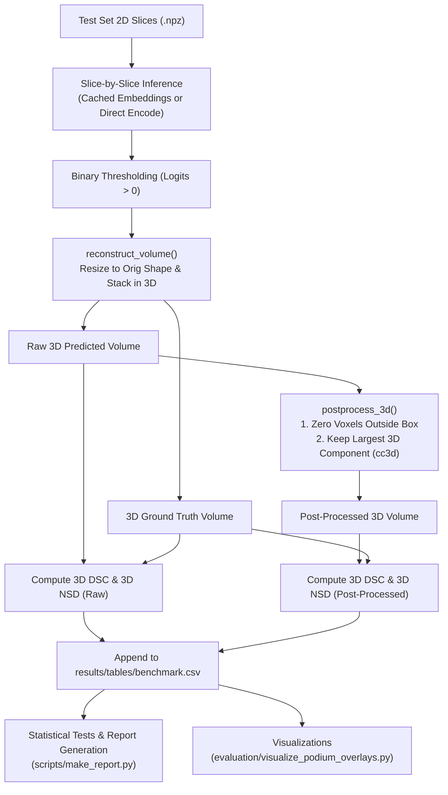

# Evaluation Methodology, Metrics, and Results Analysis

This document provides a complete guide to the evaluation protocols, volumetric metrics computation, statistical significance testing, prompt perturbation studies, domain shift benchmarks, and qualitative visualizations implemented in the MedSAM evaluation repository.

---

## 1. End-to-End Evaluation Flow

Medical image segmentation models operate on 2D slices, but clinical diagnosis and radiation treatment planning require 3D volumetric assessments. The benchmark evaluation pipeline in [scripts/run_benchmark.py](file:///c:/Users/Dhruv/VSCodeProjects/MedSAM/scripts/run_benchmark.py) executes the following sequence:



---

## 2. 3D Volume Reconstruction & Post-Processing

### 2.1 Spatial 3D Reconstruction (`reconstruct_volume`)
Defined in [evaluation/metrics.py#L63-L71](file:///c:/Users/Dhruv/VSCodeProjects/MedSAM/evaluation/metrics.py#L63-L71):
```python
def reconstruct_volume(slice_preds, volumes_json_entry):
    H, W = volumes_json_entry["orig_shape"]
    vol = np.zeros((volumes_json_entry["n_z_total"], H, W), bool)
    for z, s in slice_preds.items():
        vol[z] = cv2.resize(s.astype(np.uint8), (W, H), interpolation=cv2.INTER_NEAREST).astype(bool)
    return vol
```
1. Slices inferred at $1024 \times 1024$ are resized to the original anatomical in-plane matrix $(W, H)$ using `cv2.INTER_NEAREST` to prevent contour blurring.
2. Slices are inserted into a 3D boolean tensor spanning all $n_z\_total$ axial slices.
3. Background slices (slices omitted during preprocessing because they contained no target) remain `False`.
4. Ground-truth volumes are constructed using the exact same procedure, ensuring mathematically rigorous comparability.

### 2.2 Clinical 3D Post-Processing (`postprocess_3d`)
Medical foundation models prompted slice-by-slice can produce two common failure modes:
1. Leakage outside the intended anatomical region on ambiguous slices.
2. Spurious isolated false positive voxel clusters in distant axial slices.

The post-processing function [evaluation/metrics.py#L46-L61](file:///c:/Users/Dhruv/VSCodeProjects/MedSAM/evaluation/metrics.py#L46-L61) addresses both:
1. **Spatial Box Containment**: A boolean mask is initialized to `False`. For every slice with a bounding box prompt, voxels inside the bounding box are set to `True`. The 3D prediction is masked with this volume, eliminating any segmentation leakage outside the prompt bounds.
2. **3D Connected Component Filtering**: Connected components are extracted across the full 3D volume using `connected-components-3d` (`cc3d`). Only the single largest contiguous 3D connected component is retained (`cc3d.largest_k(labels, k=1)`), discarding isolated false positive clusters.

---

## 3. Quantitative Evaluation Metrics

### 3.1 3D Dice Similarity Coefficient (DSC)
Measures volumetric voxel overlap:
$$\text{DSC}(P, G) = \frac{2 |P \cap G|}{|P| + |G|} = \frac{2 \sum_{x,y,z} P_{xyz} G_{xyz}}{\sum_{x,y,z} P_{xyz} + \sum_{x,y,z} G_{xyz}}$$
- Implemented in `dsc(pred, gt)` in [evaluation/metrics.py#L9-L16](file:///c:/Users/Dhruv/VSCodeProjects/MedSAM/evaluation/metrics.py#L9-L16).
- If both prediction $P$ and ground truth $G$ are empty, $\text{DSC} = 1.0$.

### 3.2 3D Normalized Surface Dice (NSD)
Volumetric Dice can be deceptive: large organs with minor boundary shifts yield very high DSC, whereas small thin structures suffer drastic drops. In clinical radiation oncology and surgery, contour boundary accuracy within a physical tolerance is critical.

Normalized Surface Dice measures the fraction of the predicted boundary surface that lies within a spatial distance tolerance $\tau$ of the ground-truth surface, and vice versa:
$$\text{NSD}_\tau(P, G) = \frac{|\partial P_{\le \tau \to \partial G}| + |\partial G_{\le \tau \to \partial P}|}{|\partial P| + |\partial G|}$$
- Computed using DeepMind’s `surface-distance` library at clinical tolerance $\tau = 2.0 \text{ mm}$.
- Header voxel spacings $[s_z, s_y, s_x]$ are passed to correctly account for anisotropic voxel dimensions (e.g. $0.7 \times 0.7 \text{ mm}$ in-plane vs $5.0 \text{ mm}$ slice thickness).

### 3.3 Slice Mean DSC & Latency
- `slice_dsc_mean`: Average 2D DSC computed across foreground slices.
- `sec_per_slice`: Wall-clock GPU inference latency per slice (including data transfer and decoding).

---

## 4. Benchmark Results & Key Findings

Below is the definitive performance snapshot extracted from [results/REPORT.md](file:///c:/Users/Dhruv/VSCodeProjects/MedSAM/results/REPORT.md) (median [IQR] across test volumes, jitter 0):

| Task / Target | Metric | SAM ViT-B | U-Net (ResNet-34) | DeepLabV3+ (ResNet-50) | MedSAM ViT-B | LoRA-MedSAM (Ours) | YOLOv8n + MedSAM |
| :--- | :--- | :--- | :--- | :--- | :--- | :--- | :--- |
| **Liver** (Parenchyma) | 3D DSC | 0.915 [0.887–0.936] | 0.962 [0.953–0.968] | 0.960 [0.952–0.966] | 0.958 [0.947–0.970] | **0.959 [0.949–0.971]** | 0.946 [0.939–0.950] |
| **Liver** (Parenchyma) | 3D NSD | 0.626 [0.528–0.706] | 0.885 [0.828–0.920] | 0.880 [0.824–0.915] | 0.870 [0.813–0.915] | 0.860 [0.826–0.893] | 0.786 [0.731–0.817] |
| **Liver Tumor** (Lesion) | 3D DSC | 0.264 [0.178–0.426] | 0.538 [0.408–0.643] | **0.671 [0.651–0.716]** | 0.352 [0.235–0.525] | **0.602 [0.480–0.713]** | 0.074 [0.047–0.101] |
| **Liver Tumor** (Lesion) | 3D NSD | 0.380 [0.313–0.457] | 0.527 [0.486–0.543] | **0.762 [0.704–0.808]** | 0.428 [0.360–0.502] | 0.615 [0.510–0.666] | 0.103 [0.061–0.150] |
| **Prostate** (Whole Gland)| 3D DSC | 0.926 [0.916–0.934] | 0.930 [0.928–0.944] | 0.921 [0.912–0.935] | 0.945 [0.945–0.948] | **0.954 [0.950–0.958]** | 0.882 [0.877–0.903] |
| **Prostate** (Whole Gland)| 3D NSD | 0.915 [0.891–0.933] | 0.956 [0.947–0.960] | 0.927 [0.922–0.937] | 0.974 [0.943–0.974] | **0.985 [0.971–0.985]** | 0.793 [0.792–0.803] |

---

## 5. Statistical Significance Analysis

To rigorously establish whether observed differences are statistically significant, we execute paired two-sided Wilcoxon signed-rank tests using [evaluation/metrics.py#L29-L43](file:///c:/Users/Dhruv/VSCodeProjects/MedSAM/evaluation/metrics.py#L29-L43).

### 5.1 Per-Target Sample Size Floor
Because test sets comprise 4 volumes (Liver/Tumor) and 3 volumes (Prostate), exact per-target p-values have mathematical lower bounds:
- For $n = 3$, the minimum possible two-sided p-value is $\frac{2}{2^3} = 0.250$.
- For $n = 4$, the minimum possible two-sided p-value is $\frac{2}{2^4} = 0.125$.
Consequently, per-target Wilcoxon tests serve primarily descriptive purposes.

### 5.2 Primary Evidence: Pooled Wilcoxon Signed-Rank Tests
To achieve statistical power, we pool all 11 test volumes ($4 \text{ liver} + 4 \text{ tumor} + 3 \text{ prostate}$) into a paired test against MedSAM:

| Metric | Method Comparison | $N$ Pairs | Median Difference (MedSAM $-$ Method) | Two-Sided $p$-value | Statistical Conclusion |
| :--- | :--- | :--- | :--- | :--- | :--- |
| **3D DSC** | **SAM vs MedSAM** | 11 | $+0.0455$ | **$p = 0.0010$** | MedSAM is **statistically superior** to vanilla SAM. |
| **3D DSC** | **U-Net vs MedSAM** | 11 | $+0.0004$ | $p = 0.8984$ | In-distribution performance is **equivalent**. |
| **3D DSC** | **DeepLabV3+ vs MedSAM** | 11 | $-0.0015$ | $p = 0.5195$ | In-distribution performance is **equivalent**. |
| **3D DSC** | **LoRA vs MedSAM** | 11 | $-0.0082$ | **$p = 0.0010$** | LoRA-MedSAM **significantly outperforms** zero-shot MedSAM. |
| **3D NSD** | **SAM vs MedSAM** | 11 | $+0.0605$ | **$p = 0.0010$** | MedSAM boundary accuracy is **statistically superior**. |
| **3D NSD** | **U-Net vs MedSAM** | 11 | $-0.0115$ | $p = 0.8311$ | No significant difference. |
| **3D NSD** | **DeepLabV3+ vs MedSAM** | 11 | $-0.0071$ | $p = 0.5771$ | No significant difference. |
| **3D NSD** | **LoRA vs MedSAM** | 11 | $-0.0110$ | $p = 0.4131$ | Boundary differences are comparable. |

---

## 6. Ablation Studies

### 6.1 Prompt Sensitivity & Box-Jitter Sweep
Human clinical users cannot draw mathematically tight bounding boxes. We ablate prompt robustness by adding uniform coordinate noise $\Delta \sim \mathcal{U}[0, \delta]$ for $\delta \in \{0, 5, 10, 20, 40\}$ pixels:

| Target | Jitter Level | MedSAM 3D DSC | SAM 3D DSC | Observation |
| :--- | :--- | :--- | :--- | :--- |
| **Liver** | 0 px | 0.958 | 0.915 | MedSAM holds a +0.043 lead over SAM |
| **Liver** | 10 px | 0.958 | 0.912 | MedSAM shows zero degradation |
| **Liver** | 40 px | 0.957 | 0.900 | MedSAM drops by only 0.001; SAM drops by 0.015 |
| **Prostate** | 0 px | 0.945 | 0.926 | MedSAM baseline |
| **Prostate** | 20 px | 0.959 | 0.892 | SAM degrades rapidly (-0.034) |
| **Prostate** | 40 px | 0.945 | 0.860 | SAM suffers severe collapse (-0.066) |

#### Center-Point Prompt Failure Mode
When prompted with a single center point rather than a bounding box:
- Liver DSC collapses to **0.017**.
- Tumor DSC collapses to **0.075**.
- Prostate DSC collapses to **0.063**.
**Key Insight**: Medical structures lack the distinct high-contrast semantic object boundaries of natural images (COCO). A single point prompt lacks scale and orientation priors, proving that bounding boxes are indispensable for foundation models in radiology.

### 6.2 Sparse 3D Slice Propagation
Manually placing a bounding box on every slice of a 100-slice CT scan is time-consuming. In [evaluation/sparse_3d_propagation.py](file:///c:/Users/Dhruv/VSCodeProjects/MedSAM/evaluation/sparse_3d_propagation.py), we sample human bounding boxes only on every $k$-th foreground slice ($k \in \{1, 3, 5, 10\}$) and linearly interpolate the box coordinates along the axial $z$-axis for intermediate slices:

```
Full Dense Prompting (k=1)      Sparse Propagation (k=3)       Extreme Sparse (k=10)
  z=1: [Human Box]               z=1: [Human Box]              z=1: [Human Box]
  z=2: [Human Box]               z=2: (Interpolated Box)       z=2..9: (Interpolated Boxes)
  z=3: [Human Box]               z=3: (Interpolated Box)       z=10: [Human Box]
  z=4: [Human Box]               z=4: [Human Box]
```

- **Task03 Liver**: At $k = 10$, MedSAM retains **0.951 3D DSC** (down by only 0.007 from 0.958) while reducing required human annotations from **182 boxes down to 19 boxes**—a **90% reduction in clinician annotation burden**!
- **Task05 Prostate**: Because the prostate is thin (~14 slices total), setting $k = 10$ provides only 3 human boxes across the entire volume, causing DSC to degrade to 0.608.

### 6.3 Cross-Task Generalization & Domain Shift
To prove the core thesis of medical foundation models—that specialist models overfit to their training distribution while foundation models generalize—we cross-evaluated models trained on one modality against the other:

| Model | Liver In-Distribution DSC (CT) | Liver Cross-Task DSC (from Prostate MRI) | Liver Drop | Prostate In-Distribution DSC (MRI) | Prostate Cross-Task DSC (from Liver CT) | Prostate Drop |
| :--- | :--- | :--- | :--- | :--- | :--- | :--- |
| **U-Net** | 0.962 | 0.768 | **-0.194** | 0.930 | 0.075 | **-0.855 (Catastrophic)** |
| **DeepLabV3+** | 0.960 | 0.784 | **-0.176** | 0.921 | 0.129 | **-0.792 (Catastrophic)** |
| **MedSAM (0-shot)**| **0.958** | **0.958** | **0.000** | **0.945** | **0.945** | **0.000 (Invariant)** |

When a U-Net trained on Liver CT is applied to Prostate MRI, it collapses from 0.930 down to **0.075 DSC**. In contrast, zero-shot MedSAM maintains high accuracy across both modalities without any fine-tuning.

### 6.4 Autonomous Prompting (YOLOv8n + MedSAM)
Evaluated in [results/tables/yolo_liver.json](file:///c:/Users/Dhruv/VSCodeProjects/MedSAM/results/tables/yolo_liver.json) and [results/tables/yolo_prostate.json](file:///c:/Users/Dhruv/VSCodeProjects/MedSAM/results/tables/yolo_prostate.json):
- **Organ Segmentation**: High detector recall (Liver: 91.3%, Prostate: 91.5%) translates to strong fully automated 3D DSC (Liver: 0.946, Prostate: 0.882).
- **Tumor Limitation**: The nano detector trained for 12 epochs struggled with small, low-contrast lesions (recall: 14.6%, mean IoU: 0.26), causing fully automated tumor DSC to drop to 0.074. This represents an honest clinical limitation: small lesion detection requires dedicated multi-scale detection architectures.

---

## 7. Visualization Engine

The script [evaluation/visualize_podium_overlays.py](file:///c:/Users/Dhruv/VSCodeProjects/MedSAM/evaluation/visualize_podium_overlays.py) generates 19 publication-quality figures in `results/figures/`:

1. **Boxplots (`boxplot_{dsc,nsd}_<task>_<target>.png`)**: Method distributions displaying median horizontal lines, interquartile boxes, outliers, and minimum/maximum marker triangles.
2. **Podium Plots (`podium_<task>_<target>.png`)**: Upper panel traces individual volume performance across models; lower panel renders stacked horizontal bar charts showing the fraction of test volumes where each method ranked 1st, 2nd, 3rd, etc.
3. **Triple-Channel Qualitative Overlays (`overlay_<task>_<target>_<vol>_z<z>.png`)**: Multi-column comparison figures showing:
   - Grayscale anatomical image slice.
   - Blue bounding box prompt.
   - Magenta ground-truth contour (`cv2.findContours`).
   - Yellow semi-transparent segmentation prediction ($\alpha = 0.4$).
   - Top-left slice DSC annotation.
4. **Jitter Degradation Curves (`jitter_curve_<task>_<target>.png`)**: Plots 3D DSC vs jitter distance in pixels, contrasting MedSAM's flat curve with SAM's decline.
5. **Sparse 3D Trade-off Curves (`sparse3d_<task>_<target>.png`)**: 3-panel figure showing inference time, required human boxes, and resulting 3D DSC as a function of slice stride $k$.
