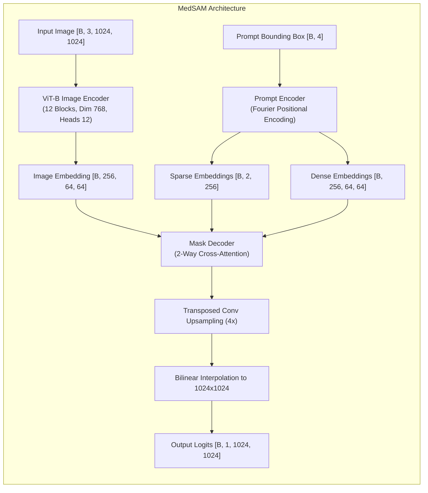
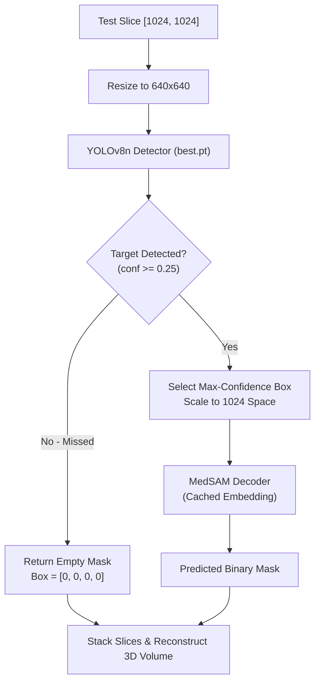

# Model Architecture, Loading, and Adaptation Reference

This document details the architectural specifications, weight initialization, checkpoint loading mechanisms, parameter-efficient fine-tuning (LoRA), specialist baseline networks, and automated prompt detection models implemented in the MedSAM evaluation codebase.

---

## 1. Architectural Taxonomy

The repository evaluates five distinct model paradigms to compare zero-shot foundation model capabilities, parameter-efficient adaptation, specialist supervised baselines, and fully autonomous segmentation:

```
                                  Model Ecosystem
                                         │
     ┌───────────────────┬───────────────┴───────────────┬───────────────────┐
     ▼                   ▼                               ▼                   ▼
Zero-Shot SAM       Zero-Shot MedSAM               LoRA-MedSAM       Specialist Baselines
(ViT-B Base)        (Medical Adapted)             (Ours, r=4)         (4-Channel 2D CNNs)
  375 MB ckpt         375 MB ckpt                 4.2M Trainable       │
  Frozen              Frozen                       Checkpointed        ├─ U-Net (ResNet-34)
                                                                       └─ DeepLabV3+ (ResNet-50)
                                         ▲
                                         │ Prompts Generated By
                                         │
                                  YOLOv8n Detector
                                (Zero-Human Automated)
```

| Model Variant | Backbone Architecture | Checkpoint Source | Trainable Parameters | Total Parameters | Input Resolution |
| :--- | :--- | :--- | :--- | :--- | :--- |
| **SAM ViT-B** | Vision Transformer ViT-B/16 | Meta AI (`sam_vit_b_01ec64.pth`) | 0 (Frozen) | 93,735,472 | $1024 \times 1024$ |
| **MedSAM ViT-B** | Vision Transformer ViT-B/16 | Wang et al. (`medsam_vit_b.pth`) | 0 (Frozen) | 93,735,472 | $1024 \times 1024$ |
| **LoRA-MedSAM** | ViT-B/16 + LoRA Q/V + Decoder | MedSAM base + LoRA adaptation | 4,205,796 (4.5%) | 93,945,394 | $1024 \times 1024$ |
| **U-Net Baseline** | ResNet-34 Encoder + U-Net Decoder | ImageNet pre-trained (`smp`) | 24,435,537 (100%) | 24,435,537 | $256 \times 256$ |
| **DeepLabV3+** | ResNet-50 Encoder + ASPP Decoder | ImageNet pre-trained (`smp`) | 26,680,721 (100%) | 26,680,721 | $256 \times 256$ |
| **YOLOv8n** | CSPDarknet53 Nano | Ultralytics (`yolov8n.pt`) | 3,157,200 (100%) | 3,157,200 | $640 \times 640$ |

---

## 2. Foundation Models: SAM and MedSAM

The core foundation segmentation models are wrapped by the `MedSAM` class in [models/medsam_wrapper.py](file:///c:/Users/Dhruv/VSCodeProjects/MedSAM/models/medsam_wrapper.py).



### 2.1 Submodules Breakdown
1. **Image Encoder**:
   - ViT-B with patch size $16 \times 16$.
   - Transforms an input image of shape $[B, 3, 1024, 1024]$ into a patch sequence of length $64 \times 64 = 4096$.
   - 12 Transformer blocks with windowed self-attention and 4 global attention blocks.
   - Neck projection outputs feature embeddings of shape $[B, 256, 64, 64]$.
2. **Prompt Encoder**:
   - Represents bounding boxes as 2 positional tokens: top-left corner and bottom-right corner.
   - For point prompts: foreground points are embedded with learned positive tokens; background points with negative tokens.
   - Generates sparse prompt embeddings $[B, 2, 256]$ and dense prompt embeddings $[B, 256, 64, 64]$.
3. **Mask Decoder**:
   - Employs two-way cross-attention: prompt tokens attend to image features, and image features attend to prompt tokens.
   - Feature maps are upscaled $4\times$ using transposed convolutions to $[B, 32, 256, 256]$.
   - A final MLP projects the token representation to compute the inner product with the upscaled features, yielding mask logits.

### 2.2 Critical Medical Normalization Nuance
Standard vanilla SAM normalizes input images using ImageNet mean and standard deviation via `sam.preprocess(image)`. In contrast, the official MedSAM training procedure by Ma et al. bypassed standard SAM preprocessing:
- MedSAM was trained by directly feeding $[0.0, 1.0]$ float tensors into `sam.image_encoder(image)`.
- [models/medsam_wrapper.py#L18-L21](file:///c:/Users/Dhruv/VSCodeProjects/MedSAM/models/medsam_wrapper.py#L18-L21) faithfully replicates this behavior:
```python
def encode(self, image):
    with torch.autocast(device_type=image.device.type, dtype=torch.bfloat16, enabled=image.is_cuda):
        emb = self.sam.image_encoder(image)
    return emb.float()
```
Bypassing `sam.preprocess` and operating directly in $[0, 1]$ prevents domain corruption of preprocessed CT Hounsfield and MRI intensity distributions.

---

## 3. Parameter-Efficient Fine-Tuning: LoRA-MedSAM

To adapt the massive foundation model to medical targets without full-parameter fine-tuning (which would cause catastrophic forgetting and require massive VRAM), we implement Low-Rank Adaptation (LoRA) in [models/lora_medsam.py](file:///c:/Users/Dhruv/VSCodeProjects/MedSAM/models/lora_medsam.py).

### 3.1 Mathematical Formulation of LoRA
For a pre-trained linear projection matrix $W_0 \in \mathbb{R}^{d \times k}$, LoRA decomposes the weight update $\Delta W$ into two low-rank matrices $A$ and $B$:
$$W = W_0 + \Delta W = W_0 + \frac{\alpha}{r} (A \cdot B)$$
where:
- $r = 4$ is the bottleneck rank ($r \ll \min(d, k)$).
- $\alpha = 4$ is the constant scaling hyperparameter ($\text{scale} = \frac{\alpha}{r} = 1.0$).
- $A \in \mathbb{R}^{d \times r}$ is initialized using Kaiming Uniform: $A \sim \mathcal{U}(-\sqrt{5}, \sqrt{5})$.
- $B \in \mathbb{R}^{r \times k}$ is initialized to zero ($B = 0$).

Because $B = 0$ at initialization, $\Delta W = 0$ at step 0, ensuring that the model starts exactly from the pre-trained MedSAM state.

### 3.2 Injection into ViT Attention Projections (`LoRAQKV`)
In SAM's ViT-B architecture, self-attention uses a fused linear projection `blk.attn.qkv`:
$$\text{qkv}: \mathbb{R}^{768} \to \mathbb{R}^{2304} \quad (\text{concatenated } Q, K, V)$$

Our custom module `LoRAQKV` wraps this fused layer, freezing $W_{\text{base}}$ and adding parallel low-rank pathways for Query ($Q$) and Value ($V$) projections while leaving Key ($K$) unchanged:

```python
class LoRAQKV(nn.Module):
    def __init__(self, qkv, rank=4, alpha=4):
        super().__init__()
        self.qkv = qkv
        for p in self.qkv.parameters():
            p.requires_grad = False
        dim = qkv.in_features               # 768
        self.dim = qkv.out_features // 3    # 768
        self.scale = alpha / rank
        self.Aq = nn.Parameter(torch.empty(dim, rank))
        self.Bq = nn.Parameter(torch.zeros(rank, dim))
        self.Av = nn.Parameter(torch.empty(dim, rank))
        self.Bv = nn.Parameter(torch.zeros(rank, dim))
        for A in (self.Aq, self.Av):
            nn.init.kaiming_uniform_(A.t(), a=math.sqrt(5))

    def forward(self, x):
        d = self.dim
        base = self.qkv(x)
        lq = (x @ self.Aq @ self.Bq) * self.scale
        lv = (x @ self.Av @ self.Bv) * self.scale
        return torch.cat([base[..., :d] + lq, base[..., d:2 * d], base[..., 2 * d:] + lv], dim=-1)
```

```
                          Input Tokens x [B, N, 768]
                                  │
                  ┌───────────────┴───────────────┐
                  ▼                               ▼
       Frozen Linear qkv(x)               LoRA Adaptations
          [B, N, 2304]                            │
          ┌───────┬───────┬───────┐       ┌───────┴───────┐
          │ Q_base│ K_base│ V_base│       ▼               ▼
          │(768)  │(768)  │(768)  │     lq = x@Aq@Bq    lv = x@Av@Bv
          └───┬───┴───┬───┴───┬───┘       │               │
              │       │       │           │               │
              ▼       │       ▼           │               │
            ( + ) ◄───┼───────┼───────────┘               │
              │       │       │                           │
              │       │     ( + ) ◄───────────────────────┘
              │       │       │
              ▼       ▼       ▼
             [ Q     ; K     ; V ] Concatenated Output [B, N, 2304]
```

### 3.3 Trainable Parameter Accounting
By modifying only the $Q$ and $V$ projections in all 12 ViT blocks and keeping the mask decoder trainable:
- **LoRA Parameter Count**:
  $$12 \text{ blocks} \times 2 \text{ projections } (Q, V) \times (768 \times 4 + 4 \times 768) = 147,456 \text{ parameters}$$
- **Mask Decoder Parameter Count**:
  $$4,058,340 \text{ parameters}$$
- **Total Trainable**:
  $$147,456 + 4,058,340 = 4,205,796 \text{ parameters } (\approx 4.5\% \text{ of the 93.9M total})$$

### 3.4 Hardware Optimization: Gradient Checkpointing
On a 6 GB VRAM GPU (RTX 3060 Laptop), standard backpropagation through 12 ViT-B self-attention blocks with batch size 1 and resolution $1024 \times 1024$ exhausts memory ($>10 \text{ GB}$ required).

We solve this by monkey-patching activation checkpointing into each ViT block in [models/lora_medsam.py#L34-L43](file:///c:/Users/Dhruv/VSCodeProjects/MedSAM/models/lora_medsam.py#L34-L43):
```python
def _checkpointed(blk):
    orig = blk.forward
    def forward(x):
        if blk.training:
            return checkpoint(orig, x, use_reentrant=False)
        return orig(x)
    blk.forward = forward
```
**Impact**: Rather than storing intermediate activation tensors across all 12 blocks during the forward pass, activations are recomputed on-the-fly during the backward pass. This slashes peak memory to **3.7 GB**, enabling stable fine-tuning on consumer hardware.

### 3.5 Checkpoint Serialization (`lora_state_dict`)
Instead of duplicating the 375 MB base model weights for every target, `lora_state_dict(sam)` extracts only the modified parameters:
```python
def lora_state_dict(sam):
    return {k: v.detach().cpu() for k, v in sam.state_dict().items()
            if k.split(".")[-1] in LORA_KEYS or "mask_decoder." in k}
```
This produces compact **~17 MB checkpoint files** (`checkpoints/lora_<task>_<target>.pth`).

---

## 4. Specialist Baselines: 4-Channel U-Net & DeepLabV3+

To establish rigorous domain-specific baselines, we train fully supervised 2D convolutional architectures using `segmentation_models_pytorch` in [models/baselines_unet_deeplab.py](file:///c:/Users/Dhruv/VSCodeProjects/MedSAM/models/baselines_unet_deeplab.py).

### 4.1 Fair Comparison via 4th-Channel Prompt Conditioning
Standard U-Net and DeepLab models are unprompted semantic segmenters. To make the comparison with promptable foundation models strictly fair, we provide the specialist baselines with the exact same bounding box prompt information:
- **Input Channels (4)**:
  - Channels $0, 1, 2$: Replicated RGB image normalized to $[0.0, 1.0]$.
  - Channel $3$: Rasterized binary prompt box mask ($1.0$ inside $[x_{\min}, y_{\min}, x_{\max}, y_{\max}]$, $0.0$ elsewhere).
```python
def make_input(image, box):
    _, _, H, W = image.shape
    masks = [np.asarray(box_to_mask_channel(b, H, W), dtype=np.float32).reshape(H, W) for b in box.cpu().numpy()]
    m = torch.from_numpy(np.stack(masks))[:, None].to(image.device)
    return torch.cat([image, m], dim=1)
```

### 4.2 Network Specifications
1. **U-Net**:
   - Encoder: ResNet-34 (ImageNet pre-trained weights).
   - Decoder: Symmetrical decoder with skip connections from encoder stages.
   - Total Parameters: 24,435,537.
2. **DeepLabV3+**:
   - Encoder: ResNet-50 (ImageNet pre-trained weights).
   - Decoder: Atrous Spatial Pyramid Pooling (ASPP) with dilation rates (6, 12, 18).
   - Total Parameters: 26,680,721.
3. **Resolution & Upsampling Protocol**:
   - Specialist baselines train and infer at $256 \times 256$ resolution.
   - For 3D volumetric metric computation, output logits are bilinearly upsampled to $1024 \times 1024$ before thresholding:
     `F.interpolate(net(x), size=(1024, 1024), mode="bilinear", align_corners=False)`

---

## 5. Automated Prompting: YOLOv8n

Foundation models require prompts. To evaluate whether human prompting can be replaced entirely, [models/auto_prompt_yolo.py](file:///c:/Users/Dhruv/VSCodeProjects/MedSAM/models/auto_prompt_yolo.py) integrates Ultralytics YOLOv8 nano.



### 5.1 Training Specifications
- Architecture: `yolov8n.pt` (~3.2M parameters).
- Input Resolution: $640 \times 640$.
- Epochs: 30 epochs for Prostate; 12 epochs for Liver (subsampled to fit training budget).
- Batch Size: 16.
- Workers: 2 (to prevent Windows multiprocessing memory issues).

### 5.2 Inference and Integration Protocol
1. The detector inspects every test slice at 640 px resolution.
2. A confidence threshold of $\tau = 0.25$ is applied.
3. If multiple boxes are detected for a target class, the box with highest confidence is selected:
   $$\text{box}_{1024} = \text{box}_{640} \times \left(\frac{1024}{640}\right)$$
4. The scaled box is passed to MedSAM to produce the segmentation mask.
5. If the detector fails to detect the target on a slice containing pathology, the slice is marked as `missed`: an empty zero-mask is generated and penalizes the 3D volume score.
